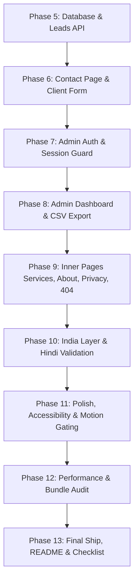

# LOOP.md — Autonomous Build, Verify, Review & Advance Pipeline

This document defines the strict autonomous loop for implementing the Ethixweb India site milestone-by-milestone.

## Core Directive
The agent must **implement, verify, review, update checklists/context, and automatically advance** to the next phase without waiting for user permission, provided all verification gate conditions for the current phase pass.

---

## The 5-Step Phase Loop

For each phase $N$ defined in `PHASES.md`:

### 1. Implement (Scope-Enforced)
- Read the Phase $N$ card in `PHASES.md` and relevant sections in `docs/`.
- Consult `graphify-out/` for existing symbols and component relationships.
- Write code strictly within the phase scope. Never touch unrelated files.

### 2. Verify (Automated Evidence)
Run the required verification suite:
- `pnpm lint` — must pass with **0 errors and 0 warnings**.
- `pnpm typecheck` — must pass with **0 TypeScript errors**.
- `pnpm build` — must pass with clean static generation.
- For API / Backend phases: execute automated curl / test requests verifying:
  - 201 on valid submission
  - 400 on too fast (< 3s)
  - 422 on invalid mobile or email
  - 403 on invalid Turnstile token
  - 429 on rate limit (≥ 3 submissions in 10 mins)
  - 401/403 on unauthorized admin access

### 3. Review & Security Audit
- **Design & UI**: Tailwind theme tokens used; no arbitrary hex; no shadows; red ≤ 5%; contrast ≥ 4.5:1; reduced-motion respected.
- **Security**: `SUPABASE_SERVICE_ROLE_KEY` is server-only; RLS enabled on `leads`; admin endpoints guard with `getUser()` + `ADMIN_EMAILS` check; CSV injection sanitized (`=`, `+`, `-`, `@` escaped).
- **Performance**: LCP element painted on first frame; `"use client"` restricted to minimal interactive islands.

### 4. Update Context & Trackers
- Update `PHASES.md` Progress Tracker: mark Phase $N$ as `[x]` with commit hash.
- Record any non-obvious technical choice in `DECISIONS.md`.
- Refresh the local knowledge graph: run `python -m graphify update .` (AST-only, fast, zero token cost).
- Commit the phase work: `git add . && git commit -m "feat: phase N 
"`.

### 5. Auto-Advance Gate
- **If all gate criteria are green**: Log a concise `PHASE N COMPLETE` status and **immediately proceed to Phase $N+1$ without pausing or asking the user for confirmation**.
- **Exception (Stop Condition)**: Stop and prompt the user **only** if:
  1. An external secret or credential not present in `.env.local` is strictly required to proceed.
  2. A blocking error cannot be resolved within the phase boundary after 3 fix attempts.

---

## Phase Execution Sequence

