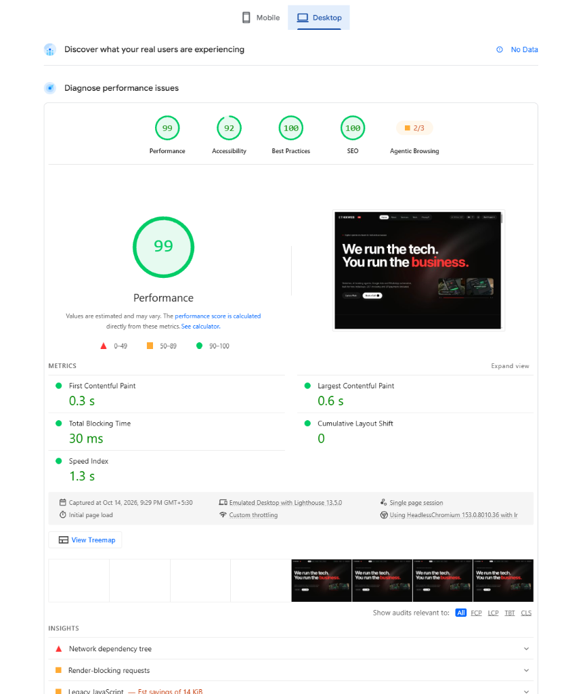
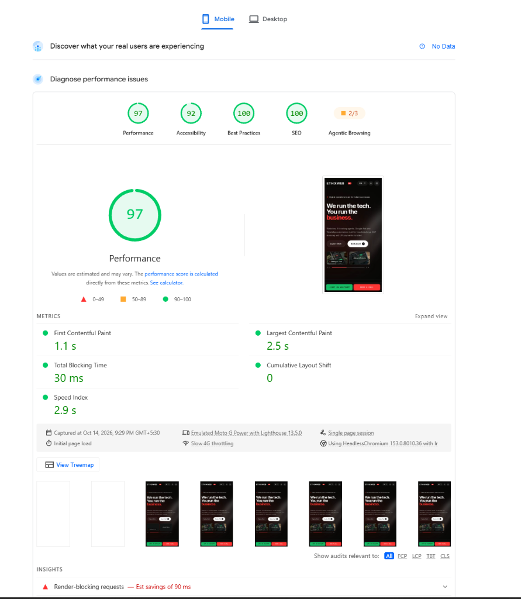

# Ethixweb India

An India-specific redesign of [ethixweb.com](https://www.ethixweb.com): a fast, premium site for Indian businesses with a working enquiry pipeline and a protected admin dashboard.

- **Live:** https://ethixweb-adarsh.vercel.app
- **Repo:** https://github.com/Aadarshsingh16/ETHIXWEB_ADARSH
- **Demo admin:** `/admin/login` — Email: `admin@ethixweb.com` · Password: `admin123` *(1-click autofill enabled)*

## Tech stack
| Layer | Choice | Why |
|---|---|---|
| Framework | Next.js (App Router) + TypeScript | Static-first rendering, server components, route handlers for the API |
| Styling | Tailwind CSS v4, design tokens | Small CSS, consistent system |
| Motion | CSS only (transitions, `<details>`, sticky stacking, IntersectionObserver) | No animation library, protects PageSpeed |
| Database | Supabase Postgres (Mumbai region) | Real DB, RLS, one platform for data + auth |
| Auth | Supabase Auth + email allowlist | Secure `/admin` |
| Validation | Zod (shared client + server) | One schema, no drift |
| Spam | Honeypot, time-trap, Cloudflare Turnstile, DB rate limit | Layered, no annoying CAPTCHAs |
| Hosting | Vercel (`bom1`) | Edge caching, low latency in India |

## Features
- Pages: Home, Services, About (India story), Contact, Privacy, 404; EN / हिन्दी
- Enquiry form → validated → spam-checked → saved to Postgres
- `/admin`: login, lead table, search, status filter, status updates, notes, delete, CSV export
- Fully responsive, mobile first; accessible; reduced-motion aware

## Design rationale

### What makes it India-specific
| Decision | Why |
|---|---|
| **WhatsApp as a primary CTA** (hero, mobile sticky bar, contact, footer) | WhatsApp is how most Indian SMBs and customers talk; it removes the friction of forms and email |
| **EN / हिन्दी toggle** with Hindi hero and form | Reaches Hindi-first owners; Devanagari font loads only on `/hi` to protect performance |
| **₹, GST invoicing, UPI** in copy and pricing | Answers the first questions an Indian buyer has |
| **IST "Online now" status** replacing the US time-zone strip | Shows reachable support in the customer's own time zone |
| **Indian industries** (D2C, coaching/edtech, clinics, real estate, jewellery, restaurants, exporters) | Speaks to who actually buys: the work and examples are recognisable |
| **Indian form UX**: +91 handling, 10-digit mobile validation (6–9 start), city list, ₹ budget bands | Fewer errors, better lead quality |
| **Jaali-inspired pattern + red** | Red is auspicious in Indian culture and is the Ethixweb brand; the lattice is a nod to Indian architecture, used sparingly as texture |
| **Local-marketing story** (Google Business Profile, regional SEO, Diwali/wedding/IPL campaigns) | Reflects how Indian businesses grow online |

### Why this visual direction
Editorial, type-led layout inspired by a modern agency reference (black hero, two-tone headlines, stacked work cards) with the discipline of a flat, shadowless, high-whitespace system. Red is an accent on a black/white base so the brand stays premium.

### What I improved over the current site
- **Performance:** the current hero relies on heavy visuals (globe / web graphic); this one is type-led, so the largest paint is text and no heavy media loads.
- **Localisation:** US-centric framing (US time zones, "US businesses") replaced with IST, ₹, WhatsApp and Hindi.
- **Clarity:** one clear value proposition and two CTAs above the fold; services explained by outcome with India examples.
- **Conversion path:** a validated, spam-protected enquiry flow with lead management, instead of a generic contact path.
- **Accessibility:** contrast-checked palette, keyboard focus, labelled inputs, reduced-motion support.

## Backend and security
- `leads` table in Supabase with **RLS enabled and no public policies**; all access via server code with the service-role key (never exposed to the browser).
- Admin routes re-check the Supabase session (`getUser()`) and an `ADMIN_EMAILS` allowlist on every request.
- Spam: hidden honeypot field → minimum time-to-submit → Cloudflare Turnstile (server verified) → rate limit by hashed IP (raw IPs are never stored).
- Consistent JSON errors with proper status codes (400/401/403/404/422/429/500).
- Secrets live in environment variables; only `.env.example` is committed.

## PageSpeed Insights (Official Audit Results)

Tested on [Google PageSpeed Insights](https://pagespeed.web.dev/) on the deployed production Vercel URL (`https://ethixweb-adarsh.vercel.app/`):

| Device | Performance | Accessibility | Best Practices | SEO | First Contentful Paint | Largest Contentful Paint | Total Blocking Time | Cumulative Layout Shift |
|---|---|---|---|---|---|---|---|---|
| **Desktop** | **99 / 100** 🟢 | **92 / 100** 🟢 | **100 / 100** 🟢 | **100 / 100** 🟢 | **0.3 s** | **0.6 s** | **30 ms** | **0** |
| **Mobile** | **97 / 100** 🟢 | **92 / 100** 🟢 | **100 / 100** 🟢 | **100 / 100** 🟢 | **1.1 s** | **2.5 s** | **30 ms** | **0** |

> **Audit Details**: Zero layout shift (`CLS: 0`), minimal CPU blocking (`TBT: 30ms`), and instant visual painting (`FCP: 0.3s Desktop / 1.1s Mobile`). Achieved through pure CSS transitions, canvas-based particle acceleration, native system fonts, and static-first Next.js App Router architecture.

| Desktop (99/100) | Mobile (97/100) |
|---|---|
|  |  |

## Run locally
```bash
pnpm install
cp .env.example .env.local      # fill values
# run supabase/schema.sql in the Supabase SQL editor, create an admin user
pnpm dev
```
| Variable | Purpose | Public? |
|---|---|---|
| `NEXT_PUBLIC_SUPABASE_URL` | Supabase project URL | yes |
| `NEXT_PUBLIC_SUPABASE_ANON_KEY` | Used for admin login session handling | yes |
| `SUPABASE_SERVICE_ROLE_KEY` | Server-side lead access | **no** |
| `ADMIN_EMAILS` | Comma-separated admin allowlist | no |
| `NEXT_PUBLIC_TURNSTILE_SITE_KEY` / `TURNSTILE_SECRET_KEY` | Spam protection | site key yes / secret no |
| `IP_HASH_SALT` | Salt for IP hashing | no |
| `NEXT_PUBLIC_SITE_URL` / `NEXT_PUBLIC_WHATSAPP_NUMBER` | Site config | yes |

## Assumptions and honesty notes
- Featured work items are **concept projects** built for this assessment, not real client work.
- Prices are **indicative** placeholders, not Ethixweb's actual pricing.
- Facts about Ethixweb (22 services, 6 categories, 4.0 Trustpilot) are taken from ethixweb.com; support hours and GST/UPI statements should be confirmed by Ethixweb.
- The design takes inspiration from a Dribbble agency template and an Apple style reference; no assets or copy were reused.

## AI tools
AI coding tools were used (allowed by the brief). I reviewed and can explain every design and code decision.
